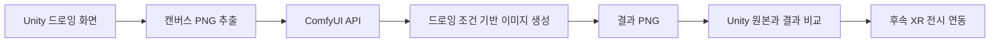

# silkroad 구현 기획 (초안 v0.1)

> 2026-10-14 작성된 구현 기획 초안. 실제 구현은 이 문서를 그대로 따르지 않을 수 있으며, 차이는 맨 아래 **구현 현황과 차이** 에 기록한다.

# 프로젝트 개요

**프로젝트명:** `silkroad`
**과제명:** 생성형 AI 기반 실크로드 문화 XR 융합콘텐츠 제작
**담당 기능:** 사용자 드로잉 이미지 변환
**개발 도구:** Unity + ComfyUI

사용자가 직접 그린 선과 색을 바탕으로 실크로드 문화 분위기의 이미지를 생성하고, 원본과 결과를 비교하며 다시 생성하거나 그림을 수정하는 체험을 구현한다. Unity는 드로잉과 체험 화면을 담당하고, ComfyUI는 이미지 변환을 담당한다.

1차 목표는 참고 영상의 **그리기 → 채색 → 보내기 → 생성 대기 → 원본과 결과 비교 → 재요청** 흐름을 실제 생성 서버와 연결하는 것이다. 생성한 이미지를 XR 공간의 액자나 전시 면에 적용하는 기능은 별도 연동 단계로 구성한다.

## 개발 기본 가정

- 초기 실행 환경은 Windows PC 또는 터치 디스플레이 1대, 생성 요청은 사용자 세션당 1건으로 가정한다.
- Unity 클라이언트와 ComfyUI는 같은 PC 또는 내부 네트워크의 GPU PC에서 실행한다.
- 최초 콘텐츠는 실크로드 회화 분위기 1종을 제공한다. 세부 지역·시대·화풍은 콘텐츠 담당자와 정한다.
- Unity 버전, GPU 사양, 생성 모델, XR 기기, 최종 납기일은 착수 시 확정한다. 일정과 성능 수치는 개발 목표이며 확정 실적이 아니다.

# 동영상 분석과 요구사항

분석 대상: `녹음 2026-04-10 173758.mp4` (약 1분 29초, 음성 없음).

| 구간 | 관찰 내용 | 구현 반영 |
| --- | --- | --- |
| 00:00 부근 | 두루마리 배경, 제목, 시작하기 버튼 | 시작 화면과 드로잉 화면 진입 |
| 00:03–00:09 | 빈 드로잉 영역, 상단 도구, 우측 보내기·지우기·메인 버튼 | 드로잉 화면의 기본 배치 |
| 00:12–00:24 | 인물, 말, 산, 물결 등 선화 | 자유 드로잉과 선 보존 |
| 00:27–00:48 | 물·땅·말·안장 등에 색이 차례로 채워짐 | 색상 선택과 영역 채우기 |
| 00:51 | 낙타 모양 표시와 ‘생성 중…’ 화면 | 비동기 생성 대기 화면 |
| 00:54–01:00 | 액자 안 원본과 AI 결과, 이동하는 세로 비교 경계 | 드래그 방식 전후 비교 |
| 01:03–01:12 | 생성 대기와 서로 다른 결과가 반복됨 | 원본을 유지하는 재생성 |
| 01:15–01:27 | 비교 경계 이동, 대기 화면, 다른 생성 결과 | 결과 확인과 반복 체험 |

드로잉 화면: 브러쉬, 지우개, 채우기, 취소, 복원, 굵기 조절, 색상 팔레트. 결과 화면: 홈, 재요청, 그림 수정.

## 설계 방향

사용자가 그린 인물과 말의 배치는 결과에도 대체로 이어지지만, 물·땅의 색과 배경 세부는 결과마다 달라진다. 품질 기준을 **주요 대상과 위치 유지, 선택 색상의 반영, 문화적 화풍의 일관성** 으로 나눈다.

## 요구사항의 근거 구분

| 구분 | 내용 |
| --- | --- |
| 사용자 확정 | 프로젝트명, 실크로드 문화 콘텐츠, 드로잉 이미지 변환, Unity + ComfyUI |
| 영상 기반 | 드로잉·채색 도구, 생성 대기, 비교 슬라이더, 재요청, 홈·그림 수정 버튼, 두루마리·액자 표현 |
| 구현 제안 | 입력 검증, 통신 오류 복구, 세션 구분, 생성 이력, 운영 설정, PNG와 메타데이터 출력 |
| 후속 확정 | XR 대상 기기·적용 장면, 문화 스타일, 모델과 GPU, 결과 저장·공유 방식 |

# 사용자 경험과 기능 범위

## 화면 구성

| 화면 | 주요 요소 | 사용자 행동과 다음 상태 |
| --- | --- | --- |
| 시작 | 체험 제목, 시작하기 | 새 세션으로 드로잉 진입 |
| 드로잉 | 캔버스, 브러시·지우개·채우기, 색·굵기, 실행 취소·다시 실행, 보내기 | 그림 작성 후 생성 요청 |
| 생성 대기 | 낙타 연출, 대기·생성·결과 수신 상태, 오류 시 복구 안내 | 완료 시 결과 화면 |
| 결과 비교 | 액자, 원본/AI 결과 라벨, 비교 슬라이더, 재요청·그림 수정·홈 | 재생성, 원본 편집 복귀, 종료 |
| 운영 설정 | 서버 주소, 스타일, 출력 크기, 제한 시간, 로그 | 현장 운영자가 설정 |

최종 콘텐츠 명칭은 별도로 확정한다. 운영 설정은 일반 체험 동선 밖에 둔다.

## 1차 구현 기능

| ID | 기능 | 구현 명세 |
| --- | --- | --- |
| F01 | 자유 드로잉 | 마우스·터치로 연속 선. 캔버스 밖 입력과 UI 조작은 그림에 반영하지 않음 |
| F02 | 색상·굵기 | 팔레트와 굵기 값을 다음 획부터 적용 |
| F03 | 지우개 | 드로잉 레이어의 선·색을 지움. 배경은 유지 |
| F04 | 영역 채우기 | 연결 영역을 선택 색으로 채움. 미세한 틈·안티앨리어싱 기준 정의 |
| F05 | 실행 취소·다시 실행 | 획 1개·채우기 1번 = 작업 1개. 최근 20개 |
| F06 | 전체 지우기·홈 | 전체 지우기 전 확인, 새 세션에 이전 그림 비노출 |
| F07 | 생성 요청 | 빈 캔버스 검사, 드로잉 영역만 PNG 전송, 중복 제출 방지 |
| F08 | 생성 상태 | 대기·생성·이미지 수신 구분. 노드 진행률을 전체 완료율로 표시하지 않음 |
| F09 | 결과 비교 | 같은 크기로 겹치고 세로 경계 드래그. 양끝에서 각각 전체 이미지 확인 |
| F10 | 재요청 | 같은 원본·스타일, seed 변경. 실패하면 직전 결과 유지 |
| F11 | 그림 수정 | 원본 드로잉 상태로 복귀 후 다시 요청 가능 |
| F12 | 오류 복구 | 서버 미연결·업로드 실패·모델 오류·시간 초과 구분, 원본 보존 |

## 체험 상태와 데이터 보존

정상 흐름 `Home → Drawing → Uploading → Queued → Generating → Downloading → Result`, 실패 시 `Error` 에서 원본 수정 또는 재시도. 그림 수정은 `Result → Drawing`, 재요청은 `Result → Uploading`. 재요청마다 새 작업 ID를 원본 ID와 연결. 늦게 도착한 이전 결과가 현재 화면을 덮어쓰지 않도록 확인. 제안 제한 시간 120초 (GPU 실측 후 조정).

## 문화 표현과 프롬프트 정책

문화 스타일은 운영자가 관리하는 프리셋으로 제공한다. 사용자가 그리지 않은 인물·말·낙타를 항상 추가하도록 강제하지 않는다. 실크로드 전체를 하나의 시대나 단일 문화로 표현하지 않도록 프리셋에 지역·시대·참조 자료를 기록한다. 생성 이미지는 창작 체험 결과로 취급하며 역사 복원 이미지로 단정하지 않는다.

## 후속 확장

- XR 공간의 액자·전시 패널에 생성 이미지를 텍스처로 적용
- 확정 버튼으로 선택한 결과만 XR 전시에 전송
- 필요 시 결과 저장, QR 다운로드, 갤러리, 다중 단말 대기열
- 3D 모델 생성, 캐릭터 분리·애니메이션, 360도 공간 생성은 별도 범위

# Unity와 ComfyUI 시스템 설계

| 영역 | 역할 |
| --- | --- |
| Unity | 입력, 드로잉 도구, 화면 상태, PNG 추출, 요청 추적, 결과 비교, XR 전달 |
| ComfyUI | 입력 전처리, 모델 실행, 스타일 적용, 이미지 저장 |
| 중계 API (선택) | 다중 단말 세션·작업 관리, 접근 제어, 요청 제한 |
| 콘텐츠 데이터 | 스타일 프리셋, 프롬프트, 검수용 그림, 참조 자료 |

워크플로: **색칠된 원본 img2img + 선·윤곽 ControlNet** 을 기준으로 비교 실험. 한 번에 한 변수만 바꾸고 같은 테스트 그림·seed로 비교. 운영 재요청은 새 seed.

API: `/upload/image` → `/prompt` → (WebSocket `/ws` 진행 이벤트) → `/history/{prompt_id}` → `/view`. 결과는 지정 출력 노드와 prompt_id로 연결하며 ‘최근 이미지’로 추측하지 않는다.

작업 기록: `sessionId, requestId, promptId, sourceImageId, workflowVersion, modelVersion, styleId, seed, width, height, status, createdAt`.

# 개발 단계와 검수 기준

| 단계 | 작업 | 완료 조건 |
| --- | --- | --- |
| 1 생성 품질 검증 | 인물·말·풍경·문양 테스트, 모델·프리셋 비교 | 기본 워크플로와 입출력 규격 결정 |
| 2 드로잉 구현 | 브러시, 지우개, 채우기, 기록, PNG 추출 | 수정 가능한 원본을 안정적으로 생성 |
| 3 API 연결 | 업로드, 실행, 상태 추적, 다운로드, 실패 처리 | Unity 입력에서 실제 결과까지 연결 |
| 4 체험 완성 | 두루마리 UI, 로딩, 비교 슬라이더, 재요청, 그림 수정 | 핵심 체험 흐름 재현 |
| 5 현장 안정화 | GPU 실측, 연속 체험, 네트워크 장애, 운영 설정 | 합의한 검수 기준 충족 |
| 6 XR 연동 | 결과 확정, 텍스처 전달, 대상 기기 검수 | 지정 XR 전시 면에 결과 표시 |

일정 초안: 개발자 1명 기준 1–5단계 약 4–6주 (1주 품질·성능 검증, 2주 드로잉, 3주 통신, 4주 체험 완성, 5–6주 안정화).

검수 기준은 `acceptance-checklist.md`, 품질·성능 목표(30건 중 24건 통과, 중앙값 20초·95백분위 40초)는 같은 문서에 정리.

## 주요 위험과 대응

| 위험 | 대응 |
| --- | --- |
| 원본과 다른 대상·구도 | 구조 조건과 변환 강도 비교, 소재별 테스트, 소재 선택 보조 |
| 원본 색상 과도 변경 | 색칠 원본 조건 유지, 변환 강도 조절, 색상 반영 별도 검수 |
| 문화 요소 무분별 혼합 | 지역·시대가 정해진 프리셋과 참조 자료, 콘텐츠 담당자 검수 |
| 느린 생성·메모리 부족 | 해상도·모델·샘플링 실측, 워밍업, 순차 처리 |
| 커스텀 노드 업데이트로 깨짐 | 모델·노드·워크플로 버전 고정, 설치 절차 기록 |
| 편집 내용 소실 | 원본 드로잉과 결과 분리, 작업 기록과 세션 보존 |

## 착수 전 결정할 사항

1. 최종 체험 장비와 입력 방식 (마우스, 터치, 펜, XR 컨트롤러)
2. GPU 모델·메모리와 ComfyUI 설치 위치, 네트워크 환경
3. 실크로드 문화의 지역·시대·화풍과 아트 리소스
4. XR 적용 범위 (기존 XR 프로젝트에 이미지 전달 / 별도 전시 장면)
5. 목표 이용 시간, 동시 단말 수, 최종 납기일
6. 결과 저장·삭제 시점과 QR 다운로드 필요 여부

---

# 구현 현황과 차이 (2026-10-14 시점)

| 항목 | 기획 | 현재 구현 | 메모 |
|---|---|---|---|
| 대상 기기 | Windows PC / 터치 디스플레이 | **안드로이드 태블릿 (뮤패드 K10 PLUS, 2000×1200)** 기준 + PC 에디터 | ComfyUI 는 같은 Wi-Fi 의 GPU PC |
| 캔버스 해상도 | 1024×576 | 1280×720 | 모델 입력 1344×768 로 정규화 |
| 지우개 | 드로잉 레이어 알파 지우기 | 종이색으로 칠하기 (단일 레이어) | 내보낼 때 배경 합성 불필요. 레이어 분리는 두루마리 아트 적용 시 재검토 |
| 실행 취소 | 변경 영역/압축 스냅샷 | 전체 스냅샷 20개 (1280×720 기준 약 70MB) | 메모리 실측 후 필요 시 변경 영역 방식으로 |
| 채우기 | 큐 기반 | 스캔라인 + 스택 (재귀 없음), 허용치 40 | |
| 진행 상태 | WebSocket | **HTTP 폴링** (`/history` + `/queue` 1초 간격) | 대기/생성/수신 단계 표시는 구현. WebSocket 은 다중 단말 시 검토 |
| 전체 지우기 확인 | 확인 | 3초 안에 두 번 누르기 (취소로 복구 가능) | |
| 운영 설정 | 서버·스타일·크기·시간·로그 | 서버 주소 + 더미 모드 (기기에 저장) | 스타일/시간은 Inspector·프리셋 파일 |
| 결과 확정 → XR | 확정 버튼 | 결과 화면 ‘저장’ = 확정 → `XRResultBridge.Publish` | 자동 저장은 파일만, XR 전달은 확정 시에만 |
| 메타데이터 | 12개 항목 | sessionId, requestId, sourceImageId, promptId, seed, styleId, workflow, width, height, elapsedSeconds, createdAt | modelVersion·workflowVersion 은 node-mapping 버전으로 추후 추가 |
| 제목 | 참고 영상 명칭 | 임시 ‘실크로드 그림 공방’ | 최종 명칭 확정 후 교체 |
